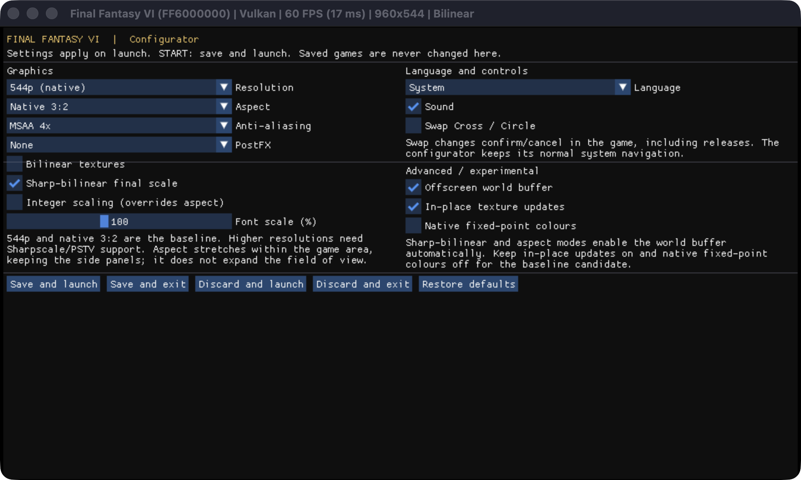

# Final Fantasy VI Vita

[](https://github.com/frangarcj/ff6_vita/actions/workflows/compilation.yml)

This is a wrapper/port of *Final Fantasy VI Android* for the *PS Vita*.

The port works by loading the official Android ARMv7 executable in memory,
resolving its imports with native functions and patching it in order to
properly run.

## Current status

The first public GitHub candidate is **v1.0.0-rc1**. Earlier documents labelled
RC1/RC2 describe local development snapshots, not earlier public releases.
The follow-up fixes reused glyph cells and vertical text alignment, adds an
optional sharp-bilinear final upscale, and maps battle-menu clipping into the
offscreen buffer. Battle/action-menu captures and host regressions cover these
changes. Obsolete diagnostic freezes and presentation probes have been removed;
Release builds exclude diagnostic logs, status files and test triggers.
Broader dialogue, menu, battle and real-hardware checks remain pending; this
is a release candidate, not stable-release signoff.

### Features

- A **LiveArea Configurator**, with safe configuration saving, language, audio,
  MSAA, filtering, font scale, resolution and control options.
- **Swap Cross/Circle**, native/720p/1080i output selection with VitaGL fallback,
  and optional presentation aspect ratios. FF6 retains its original 2D view;
  these ratios stretch inside the game area rather than expanding the camera.
- Seven optional **PostFX** effects adapted from `ff3_vita`: Negative, FXAA,
  Sepia, Greyscale, CRT, CRT-Bleeding and CRT-Bleeding-Flat. They apply after
  world scaling and UI composition; sharp-bilinear remains independent.
- Automated host regressions, VitaSDK builds, package/provenance checks and
  tag-based GitHub prereleases. See [FF3 parity and limits](docs/FF3_PARITY.md).

Historical July 2026 testing on real Vita hardware confirmed an improvement
to Narshe scrolling after enabling in-place texture updates. The subsequent
menu/battle graphics fix still needs a fresh hardware check. A successful
build alone does not establish that the candidate is ready for release.

Normal-save and quicksave round trips also need verification. The code
contains fixes for Android file-open flags, save paths and reading all save
slots; older investigation notes that call saving broken predate or conflict
with those changes. No completed save-persistence test is recorded yet.

See [the public RC1 verification](docs/PUBLIC_RC1_VALIDATION.md) for Configurator,
PostFX and workflow evidence, [the release checklist](docs/RELEASE_CHECKLIST.md) for the acceptance gates,
[the RC2 report](docs/RC2_VALIDATION_2026-10-25.md) for the current evidence,
[the RC1 report](docs/VALIDATION_2026-10-25.md) for earlier checks, and
[HUNT.md](HUNT.md) for the historical investigation. Known limitations
include thin seams between tiles and unavailable Google Play services such as
cloud saves and achievements. Offscreen rendering and native fixed-point
colors are experimental options and are disabled by default.

## How it works

Unlike [ff3_vita](https://github.com/frangarcj/ff3_vita), whose `.so` exposes a
tiny custom `render()`/`touch()` API, `libFF6.so` is a stock Android
**NativeActivity** built on `android_native_app_glue`:

```
ANativeActivity_onCreate
  -> android_main            pumps an ALooper; no drawing happens here
       -> engine_handle_cmd  APP_CMD_INIT_WINDOW -> initGame()
            -> initGame      SetupObbFile, sound, save data, ... then thread_init()
                 -> thread_main   <- the real game thread
                      initDisplay()   EGL + GLES1 setup
                      AgbMain()       the GBA-style main loop
```

`libFF6.so` ships with its symbol table intact (~15,000 exported symbols), so
instead of emulating the looper, the input queue and the activity lifecycle,
the loader drives the engine directly:

```c
initMainFrame();
File_SetAAssetManager(&fake_activity);
g_app->app = &fake_android_app;
initGame();                 /* spawns thread_main on its own */
```

From there the game's own thread and AGB main loop run against the loader's
EGL, GL and OpenSL ES implementations. The Vita input thread has the same job
the glue's main thread had: feeding input. It does that by
synthesizing `AInputEvent` objects (the loader owns the `AInputEvent_*`
accessors, so the struct layout is its own) and handing them to the engine's
own `InputDriverAndroid_onInputEvent()` and `inputMotion()`. The original
engine retains its auto-repeat, virtual-pad and button-configuration logic.

### Notes about the game itself

FF6 Android is a port of **Final Fantasy VI Advance** (Game Boy Advance, 2006),
not of the SNES version. The original AGB code is still in there --  `AgbMain`,
`int_VBlankFunc`, the `m4a`/MusicPlayer2000 sound driver, software
reimplementations of the GBA BIOS calls (`CpuSet`, `LZ77UnCompVram`, ...) and
the PPU state kept in plain RAM (`AgbIo` is 0x400 bytes, `AgbExRam` is the GBA's
256 KB of EWRAM). What was replaced is the hardware layer: the PPU became an
OpenGL renderer and the cartridge became the `.obb`.

Two consequences matter for this port:

- The loop is a **60 Hz GBA loop** with no delta-time, so vsync has to be
  respected.
- Battles switch to a separate, **depth-buffered** renderer
  (`BattleHighReso_*`). It is the only path that uses the depth buffer, so
  vitaGL must be brought up with one -- otherwise the field looks fine and
  combats render wrong.

## Setup Instructions (For End Users)

Use a legally obtained copy of the original Android game containing
`lib/armeabi-v7a/libFF6.so` and its matching OBB data. The VPK supplies the
loader and fonts; it does not supply the commercial game executable or data.
The reference game is Android version **2.1.6** (`versionCode=216`), package
`com.square_enix.android_googleplay.FFVI`. Compatibility with other revisions
has not been established. The matching OBB is named
`main.21701.com.square_enix.android_googleplay.FFVI.obb` before renaming; its
number does not match the APK's versionCode, so verify the actual files.

| File | Size in bytes | SHA-256 |
| --- | ---: | --- |
| `libFF6.so` | 22,340,224 | `f612f711330238cf405a403fb084abd2b8d7c9e72f9867740aed2b834fc731e6` |
| `main.obb` | 654,927,616 | `4f443b8d0be0a7976f8dd540cccb24a643937afd6eec043e7bf7d13fe427369f` |

Check your extracted files on the build computer without modifying them:

```bash
python3 tools/verify_game_data.py --so "/path/to/libFF6.so" --obb "/path/to/main.obb"
```

The loader checks the supported executable's size and CRC32 before parsing
it. The helper above checks SHA-256 for both the executable and the OBB.

1. Install [kubridge](https://github.com/TheOfficialFloW/kubridge/releases/)
   and [FdFix](https://github.com/TheOfficialFloW/FdFix/releases/) in your
   active taiHEN plugin configuration. For example, if your plugins are in
   `ux0:tai`, add the following under `*KERNEL`:

   ```
   *KERNEL
   ux0:tai/kubridge.skprx
   ux0:tai/fd_fix.skprx
   ```

   Use the paths for your own active plugin directory. Do not add FdFix if
   you already use rePatch, and do not duplicate existing plugin entries.

2. Install `libshacccg.suprx` if needed; the loader checks
   `ur0:data/libshacccg.suprx` and `ur0:data/external/libshacccg.suprx`.
   The [shader compiler setup guide](https://samilops2.gitbook.io/vita-troubleshooting-guide/shader-compiler/extract-libshacccg.suprx)
   describes extraction.
3. Create `ux0:data/ff6`. Copy the matching Android OBB there as `main.obb`.
   Its Android source is normally under
   `/sdcard/Android/obb/com.square_enix.android_googleplay.FFVI/`.
4. Open your APK as an archive and copy `lib/armeabi-v7a/libFF6.so` to
   `ux0:data/ff6/libFF6.so`.
5. Install [FF6.vpk from the release page](https://github.com/frangarcj/ff6_vita/releases/tag/v1.0.0-rc1).
   Keep a backup of any existing `RockDat*.sav` files before
   testing a candidate or replacing an earlier build.

The final layout should be:

```
ux0:data/ff6/libFF6.so
ux0:data/ff6/main.obb
ux0:data/ff6/options.cfg   (optional)
```

Save data is stored alongside these files as `RockDat*.sav`. Replacing the
VPK does not require replacing or deleting that directory. The loader
requests 444 MHz CPU, 222 MHz bus/GPU and 166 MHz GPU crossbar clocks at startup.

The D-pad and left stick provide directional input. Face buttons, shoulder
buttons, Start and Select are forwarded as Android gamepad buttons, and the
front touchscreen supplies touch input. Use the game's own button settings
for its action mapping.

### Configurator

Open **Configure** in the game's LiveArea to launch the bundled companion.
It works without the commercial game files. Navigate with the gamepad, choose
**Save and launch** (or press **START**) to apply options and start the game.
Save/exit and discard actions are also available. A failed save is reported
instead of silently launching; comments and unknown configuration keys are
preserved. Saved games are never written by the Configurator.



The original 544p, native 3:2 layout remains the default. Higher output modes,
alternative aspect ratios and PostFX are experimental until checked on your
hardware. Integer scaling takes precedence over the aspect selection. For the
sharp-bilinear presentation used in the menu tests, select **Sharp-bilinear
final scale** and keep **Font scale = 100**.

### options.cfg

Create this optional file in `ux0:data/ff6`, or use the Configurator. Use one
`key=value` entry per line and restart the game after changing it. Whitespace
and `#`/`;` comments are accepted; malformed/out-of-range values use safe
defaults. Omitting
the file uses these defaults:

| Key | Default | Accepted settings |
| --- | --- | --- |
| `resolution` | `0` | `0` 960x544, `1` 1280x725, `2` 1920x1088; hardware support required, otherwise VitaGL falls back to native |
| `swap_buttons` | `0` | `1` swaps Cross/Circle confirm/cancel, including key releases |
| `aspect_ratio` | `0` | `0` native 3:2, `1` 4:3, `2` 16:9, `3` 2:1, `4` 21:9; presentation stretch within the original game area, not a wider field of view |
| `postfx` | `0` | `0` none, `1` Negative, `2` FXAA, `3` Sepia, `4` Greyscale, `5` CRT, `6` CRT-Bleeding, `7` CRT-Bleeding-Flat |
| `bilinear` | `0` | `0` nearest for non-atlas textures, `1` linear; registered glyph atlases always use linear sampling |
| `integerscale` | `0` | `0` fill the normal 3:2 game area, `1` use a whole-number scale |
| `language` | `0` | `0` system language; explicit values below |
| `antialiasing` | `2` | `0` off, `1` MSAA 2x, `2` MSAA 4x |
| `sound` | `1` | `0` disable audio, `1` enable audio |
| `fontscale` | `100` | 25..400 percent of the requested EM text size; the Configurator slider offers 25..200 |
| `inplacetex` | `1` | `1` update atlas textures in place, `0` use vitaGL's normal texture-update path |
| `sharpbilinear` | `0` | Experimental: `1` enables a low-resolution scene buffer and a sharp-bilinear final upscale; independent of `bilinear` |
| `offscreen` | `0` | Experimental: `1` enables the scene buffer with ordinary bilinear presentation when `sharpbilinear=0` |

Language overrides are `1` Japanese, `2` English, `4` German, `5` French,
`6` Italian, `7` Spanish, `8` Simplified Chinese, `9` Traditional Chinese,
`10` Korean, `11` Thai, `12` Russian and `13` Brazilian Portuguese. These are
the loader's mappings; text rendering in every language is not yet verified.
The bundled fonts do not cover the tested Thai characters, so `language=11`
does not provide complete Thai text rendering. Complex combining-text
fallback and shaping are not guaranteed.

For example, to keep the default rendering and select Spanish:

```ini
language=7
```

The engine uses its normal 3:2 game area: 816x544 within the Vita's 960x544
display. `aspect_ratio` changes only its final presentation and preserves the
screen-space side panels. `aspect` is not a recognized alias. `bilinear=2`
is not a supported filtering mode.

#### Filtering

The engine composes a 480x320 world and the port scales it to the 816x544 box,
a 1.7x factor. With `bilinear=0`, ordinary art textures use `GL_NEAREST`:
source pixels can cover one or two screen pixels depending on where they
land, which can shimmer as the camera moves. `bilinear=1` uses `GL_LINEAR`
and smooths those textures, including the pixel art.

The two registered glyph-atlas pages use `GL_LINEAR` in either mode so
rasterized font coverage is not forced through nearest sampling. The loader
tracks those atlas handles and forgets them on deletion or page replacement;
an unrelated texture reusing a deleted handle follows the normal setting.
This exception is specific to the glyph atlases. The separate full-string
`createTextTexture`/`drawText00` path is not classified as an atlas and still
follows the general `bilinear` override.

Glyph uploads replace the entire atlas cell with transparent padding around
the new bitmap, so reusing a cell for a narrower or shorter glyph does not
leave pixels from its previous occupant. A host regression reproduces the
old stale-cell contents and checks the correction and neighboring cells.
See the [menu-atlas follow-up](docs/MENU_ATLAS_VALIDATION_2026-10-25.md)
for the bounded build and emulator evidence; broader menu and hardware
acceptance remains pending.

`integerscale=1` is the other way to get an even pixel grid: it shrinks the
game area to the largest whole multiple of 480x320 that fits. On a 544-tall
panel that is only 1x, giving a centered 480x320 game area. Thin tile seams
remain a known visual issue; a filtering option is not a verified fix for it.
Integer and aspect modes enable the scene buffer and inverse-map touch input;
they do not change the game's logical layout or glyph metrics.

`sharpbilinear=1` enables an experimental programmable final pass. It renders
the scene at 480x320, then remaps texture coordinates to match an integer
nearest prescale followed by a bilinear resize. The 816x544 output uses a
2x prescale in each direction, without allocating that intermediate image.
This is not the same as setting `bilinear=1` on the game's textures, nor
does it reconstruct texels that have already bled inside a game atlas.

The compositor isolates its shader attributes from the engine's fixed-function
state and converts screen-space UI scissor rectangles into scene-buffer
coordinates. It restores the original clipping rectangle for display overlays.
With `offscreen=1` and `sharpbilinear=0`, the same final pass uses ordinary
bilinear sampling. Both options default to `0` and still need broad menu and
hardware validation. In Debug builds only, `upscale-status.txt` records the
selected final filter and dimensions after its first draw; it is not a
substitute for checking the rendered image. Release does not write that file.

#### Font size and existing configurations

`fontscale=100` now uses the EM size requested by the Android engine
(`stbtt_ScaleForMappingEmToPixels`). The previous implementation made the
font's entire ascent/descent box fit that size, which reduced the glyphs.
The current vertical box is the separately rounded scaled ascent plus the
magnitude of the descent of the bundled Noto font; it is not a claim to
reproduce Android's default font's exact top/bottom metrics or layout.

The raster baseline is separate from that conservative box. A fixed capital
`H` reference centers the visual baseline for each font and size, rather than
letting Noto's extra top space move the letters below their menu icons. It does
not center each word independently. At sizes 19 and 28 this moves the bitmap
baseline up two pixels without changing the font scale, advance widths or
reported height. Coverage tests include ASCII, Spanish accents, descenders and
sampled Cyrillic/CJK characters in all three bundled fonts.

Existing `fontscale` overrides are not converted automatically. Start with
`100` and reassess a value chosen for the older build. For the bundled JP
font, ascent `1160`, descent `-288` and `1000` units per EM give an unclamped
scale ratio of `1.448` between the new and old meanings of `100`. A value of
about `69` now approximates that font's previous `100` scale; this is a
font-metric comparison, not a verified Android screenshot match.

#### Experimental options

| Key | Default | Purpose and limitation |
| --- | --- | --- |
| `offscreen` | `0` | `1` draws the world into an intermediate buffer. Hardware correctness and performance remain unverified. |
| `fixedcolor` | `0` | `1` uses native `GL_FIXED` colors in the patched vitaGL shader path. Requires that patch and hardware validation. |

Keep both at `0` for the baseline candidate. The default `fixedcolor=0`
converts fixed-point colors in the loader. `inplacetex=0` is useful for
diagnosing texture corruption, but can restore the severe Narshe slowdown.

## Build Instructions (For Developers)

Set `VITASDK` to your [VitaSDK](https://github.com/vitasdk) installation, then
install the libraries used by `CMakeLists.txt`, including:

- [libmathneon](https://github.com/Rinnegatamante/math-neon) -- `make install`
- [vitaShaRK](https://github.com/Rinnegatamante/vitaShaRK) -- `make install`
- [kubridge](https://github.com/TheOfficialFloW/kubridge) --
  `mkdir build && cd build && cmake .. && make install`
- A patched [vitaGL](https://github.com/Rinnegatamante/vitaGL) providing
  `vglInPlaceTexSubImage`. Follow [deps/README.md](deps/README.md) to build
  upstream commit `c707ff00d9a372f0ba7056b4a4b723f5a00ba880` with the bundled
  FF6 patch. Its required release flags are `NO_DEBUG=1 NO_SPLASHSCREEN=1
  SHARED_RENDERTARGETS=1 ENABLE_LEGACY_PIPELINE=1`. The last flag is required
  by the Configurator's ImGui backend. The patch also provides native `GL_FIXED` color
  support for the optional `fixedcolor=1` path.
- [opensles](https://github.com/frangarcj/opensles) --
  `cd libopensles && make install`
- [imgui-vita](https://github.com/Rinnegatamante/imgui-vita) -- `make install`

The automated source revisions are recorded in `deps/build.lock.json`. In a
fresh, isolated VitaSDK environment, `python3 tools/build_dependencies.py`
builds those dependencies under `build_ci/deps` (OpenSL ES and ImGui install
into that SDK). Do not run it against an SDK whose shared libraries you need
to preserve. The CI workflow uses the official VitaSDK container, as in FF3.

After preparing that project-local dependency, build the candidate with
instrumentation disabled:

```bash
cmake -S . -B build_release -DCMAKE_BUILD_TYPE=Release -DFF6_DEBUG=OFF \
  -DVITAGL_INCLUDE_DIR="$PWD/build_release/deps/vitaGL/source" \
  -DVITAGL_LIBRARY="$PWD/build_release/deps/vitaGL/libvitaGL.a"
cmake --build build_release --parallel 4
```

The two `VITAGL_*` paths select the project-local build without replacing the
SDK's shared library installation. CMake checks both the header declaration
and the archive symbol for `vglInPlaceTexSubImage` before building. The pinned
source/patch recipe has been built with VitaSDK GCC 15.2.0; it does not promise
identical output bytes across different SDK installations or source paths.

The outputs include `build_release/FF6.vpk`, `build_release/companion.bin` and
the matching `FF6.elf` / `companion.elf`. Retain both ELFs to investigate crash dumps from that
exact build. Validate and stage the package with:

```bash
python3 tools/check_release.py build_release --output release/v1.0.0-rc1
```

This checks the release build settings, VPK contents and metadata, and stages
`FF6.vpk`, `FF6.elf`, `companion.elf`, `manifest.json` and `SHA256SUMS` in the selected directory.
It rejects known diagnostic paths/markers as well as a Debug profile, while
retaining crash-report symbols in the standalone ELF. Package validation does
not mark the hardware tests complete. Record the tested
artifact identity in the release checklist.

Debug builds use a separate directory and `-DFF6_DEBUG=ON`; they enable
`boot.log`, GL tracing, trigger files and other investigation tools. They also
require an instrumented vitaGL archive exporting `vgl_debug_log_draws` and
`vgl_debug_scene_splits`; CMake checks for these when debug mode is selected.
The swap regression covers both profiles: neither may inject diagnostic waits,
pixel-readback probes or overlay draws into frame presentation.

The public release checker requires the Configurator, all seven shader pairs,
license notices and LiveArea resources. Original indexed PNG assets can be
regenerated with `python3 tools/generate_livearea.py`; no commercial artwork
is needed for that build step.

### Tests and workflows

Run `python3 tools/run_host_tests.py` without VitaSDK or game data. It compiles
nine C regression suites with ASan/UBSan and checks frame-presentation order
and bundle resources. After a cross-build, run
`python3 tests/test_release_profile.py build_release/FF6.elf` and the same
command for `companion.elf` to exercise diagnostic rejection.

`CI` builds pushes, pull requests, manual runs and `run_build` dispatches. It
uses pinned source dependencies and uploads a verified VPK, symbols and
provenance bundle. Public CI uses `--require-clean-source` so an unknown Git
revision or dirty checkout cannot silently produce a release bundle.
`Release` builds version tags, verifies the bundle's commit
and checksums, and publishes with `gh`. Tags ending in `-rcN` are prereleases,
not the latest stable release. Existing releases/assets are never overwritten
by the workflow; fixes require a new version tag. Actions are pinned by commit.

## Credits

- TheFloW for the initial arm elf loader.
- Rinnegatamante for vitaGL and fixes.
- The `ff3_vita` contributors for the Configurator pattern and PostFX sources.
- Omar Cornut and the Vita ImGui port contributors for the configuration UI.

See [LICENSE](LICENSE) and [THIRD_PARTY_NOTICES.md](THIRD_PARTY_NOTICES.md) for
the project license and bundled third-party notices, including the Noto fonts.
