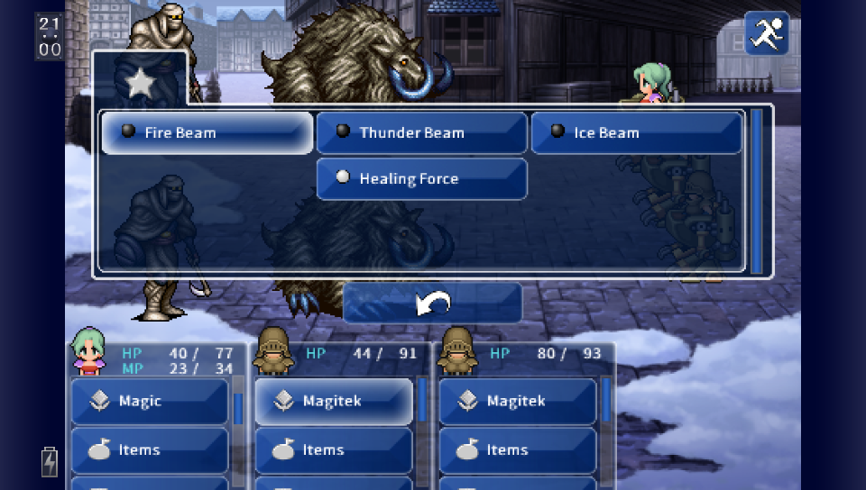

# Final Fantasy VI Vita

<p align="center">
  
</p>

[](https://github.com/frangarcj/ff6_vita/actions/workflows/compilation.yml)

A port of *Final Fantasy VI (Android)* for the **PlayStation Vita**, based on the original ARMv7 game. Like [FF3 Vita](https://github.com/frangarcj/ff3_vita), it loads the Android game files instead of including them in the download. You'll need your own copy of the game.

**Download:** [FF6.vpk (v1.0.0-rc1)](https://github.com/frangarcj/ff6_vita/releases/download/v1.0.0-rc1/FF6.vpk)

## Installation

1. Install [kubridge](https://github.com/TheOfficialFloW/kubridge/releases/) and [FdFix](https://github.com/TheOfficialFloW/FdFix/releases/) in your Vita's active taiHEN plugins folder. Add them under `*KERNEL` in `config.txt`, adjusting the paths if necessary:

   ```text
   *KERNEL
   ux0:tai/kubridge.skprx
   ux0:tai/fd_fix.skprx
   ```

   **Note:** If you already use rePatch, don't install FdFix.

2. Install `libshacccg.suprx` if you don't have it yet. Follow [this guide](https://samilops2.gitbook.io/vita-troubleshooting-guide/shader-compiler/extract-libshacccg.suprx).

3. Get the **Android 2.1.6** version of Final Fantasy VI from your own legally obtained copy, including its APK and matching OBB. Other versions haven't been verified.

4. Create `ux0:data/ff6` and copy these files into it:

   ```text
   ux0:data/ff6/libFF6.so    (from the APK: lib/armeabi-v7a/)
   ux0:data/ff6/main.obb     (the matching Android OBB, renamed)
   ```

5. Install **FF6.vpk** on your Vita and launch the game.

Your saves are stored as `RockDat*.sav` in `ux0:data/ff6`. Back them up before updating, but **don't delete the folder** when installing a new VPK. If you're unsure which Android files you have, you can check them with [verify_game_data.py](tools/verify_game_data.py).

## Configuration

Select **Configuration** on the game's LiveArea to open the settings app. You can change the resolution, language, sound, buttons, font size and optional filters such as sharp-bilinear, FXAA and CRT. Press **START** to save and launch the game.

<p align="center">
  
</p>

The original 544p mode is the default. Higher resolutions, alternative aspect ratios and PostFX are optional and may perform differently on real hardware. You can also edit `ux0:data/ff6/options.cfg` manually.

## Building

You'll need [VitaSDK](https://github.com/vitasdk) and the dependencies listed in [deps/README.md](deps/README.md), including the **FF6-patched vitaGL**. Follow that guide to prepare the libraries before building:

```bash
cmake -S . -B build_release -DCMAKE_BUILD_TYPE=Release -DFF6_DEBUG=OFF \
  -DVITAGL_INCLUDE_DIR="$PWD/build_release/deps/vitaGL/source" \
  -DVITAGL_LIBRARY="$PWD/build_release/deps/vitaGL/libvitaGL.a"
cmake --build build_release -j4
```

The installable package is `build_release/FF6.vpk`. You can run the host tests with `python3 tools/run_host_tests.py`, or check the package with `python3 tools/check_release.py build_release`. GitHub Actions also builds the port automatically; see the [CI workflow](.github/workflows/compilation.yml).

## Credits

- TheFloW for the original loader.
- Rinnegatamante and the FF3 Vita contributors for vitaGL, the Configurator and PostFX work.
- Omar Cornut and the Vita ImGui contributors.
- **Standard-Republic** for the LiveArea artwork and layout. Thank you!

This is still a release candidate. If you find a bug, please [open an issue](https://github.com/frangarcj/ff6_vita/issues). See the [release checklist](docs/RELEASE_CHECKLIST.md) for outstanding tests and [third-party notices](THIRD_PARTY_NOTICES.md) for licenses and attributions.
