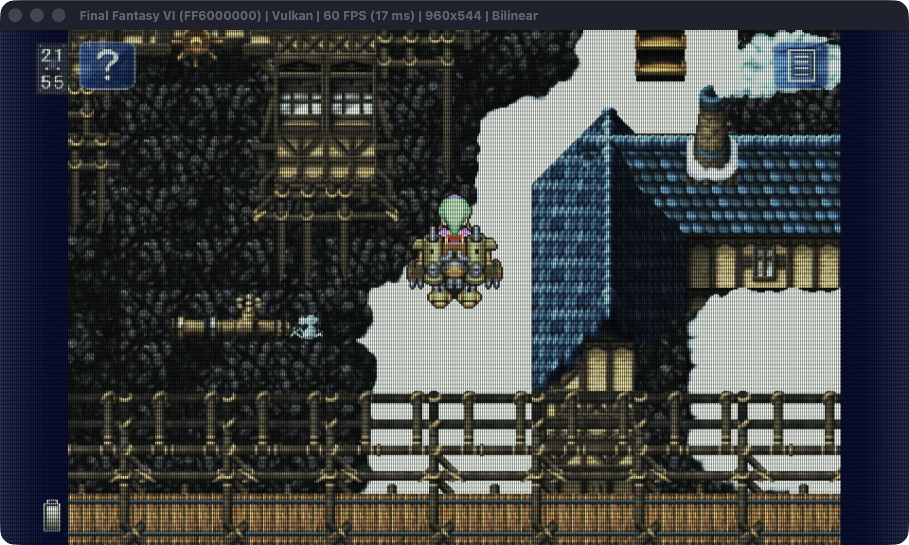

# Public RC1 verification record

This report covers the FF3-parity additions to FF6's first public release
candidate. It supplements, rather than replaces, the earlier local font/menu
validation reports. The authoritative public source revision and artifact
checksums are in the release bundle's `manifest.json` and `SHA256SUMS`.

## Source and packaging

The FF3 reference is commit `f08d74fb29b149134465f212257766ce86de6878`.
The [parity matrix](FF3_PARITY.md) distinguishes engine-specific behavior from
shared functionality. The VPK contains both native executables, all fourteen
PostFX shader source files, all LiveArea resources, the three licensed Noto
fonts and license notices. It contains no APK, Android executable/OBB or saves.
Both unstripped native ELFs are retained separately for crash reports.

The new settings parser and Configurator share defaults and validation. Host
tests cover malformed/overflowing values, unknown-key/comment preservation,
replacement through a temporary file, refusal to truncate malformed old
configuration, Cross/Circle round trips, native/output dimensions, aspect and
integer-layout mapping, and inverse touch mapping. The existing font, atlas,
encoding, file, sharp-scaling and scissor suites continue to pass.

`tools/run_host_tests.py` passed nine C suites with ASan/UBSan, frame order in
Release and Debug for 2,100 frames, and resource completeness checks. Both
Release native binaries passed the diagnostic-rejection tests (nine negative
fixtures each). The VPK checker verifies packaged bytes against the matching
build and source resources. `actionlint` accepted both workflows.

## Configurator runtime

An initial smoke exposed that ImGui's Vita backend calls `vglDrawObjects`,
which is a no-op when vitaGL is built without `ENABLE_LEGACY_PIPELINE=1`.
The source recipe and dependency lock now require that flag, and the library
was rebuilt from clean objects before repeating the tests.

After that correction, a process-specific macOS window capture of the
Configurator showed every settings group and Save/Discard action. The exact
process/window identity was checked: earlier generic screen-region captures
could pick up another running emulator and were not accepted as evidence.

The native **START / Save and launch** path was also exercised in a private
emulator filesystem. The log recorded creation of the temporary options file,
`sceIoRename` to `options.cfg`, `sceAppMgrLoadExec` to `app0:/eboot.bin`, and
loading of the FF6 executable. The resulting file preserved an unknown
`future_option=87` entry and its preceding comment while writing the validated
settings. Source save hashes were unchanged. The test was explicitly stopped;
it is not a save-game persistence test or a complete application session.

Local receipts: `build_release/parity-0-b329693m/receipt.json` (UI) and
`build_release/parity-0-togwe7oy/receipt.json` (save/launch). These ignored
workspaces are not distribution contents. Release did not create `boot.log`.

## PostFX runtime

Each of the seven effects was launched separately at 960x544 with
sharp-bilinear enabled. Debug runtime logs confirmed compilation/linking of the
selected program for IDs 1 through 7. All seven processes remained alive for
the bounded test, and original source save hashes remained unchanged. Those
logs establish shader activation, not exhaustive visual correctness.

A separate process-specific capture of CRT-Bleeding-Flat showed the Narshe
field rendered with the CRT effect and the world upright, with side panels
present. The captured run used the existing debug autoplay to reach the scene.

Local receipts for the seven activations are in `build_release/parity-*/`;
the inspected CRT capture is `parity-7-r5w48vzy/window.png`.
No hardware frame-rate or comparative performance claim is made from the
emulator's window title.

## Workflow verification and provenance guard

The first repository CI run built and tested both binaries successfully, but
artifact inspection exposed a container Git ownership problem: Git revision
queries failed and the artifact was named `FF6-`. That bundle is **not** an
acceptable public release bundle despite the initial green job status.

The corrected workflow trusts only its mounted checkout path, fails immediately
if revision lookup fails, and uses `--require-clean-source` in the package
checker. A local negative test rejects a dirty/unknown source identity. The
Release job independently requires its manifest revision to equal the checked
out tag and `source_dirty` / `ff6_debug` to be false before invoking `gh`.
Existing releases are never overwritten by the workflow.

## Still open

Higher output modes, alternative aspect presentation, optional effects on real
Vita/PSTV, full language/layout coverage, sustained play, suspend/resume, normal
save/quicksave exit-reload cycles, and the first/repeated Fire Beam in the final
release remain acceptance tasks. This candidate is published as a prerelease;
these checks are not implicitly completed by compilation, host tests, or the
bounded emulator observations above.
